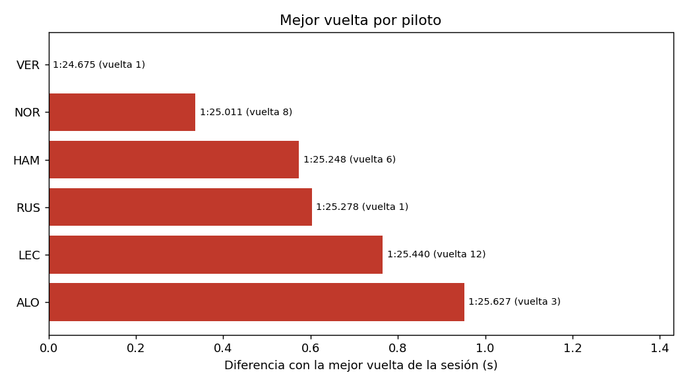
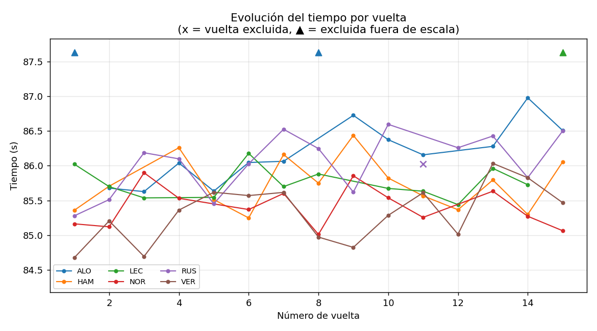
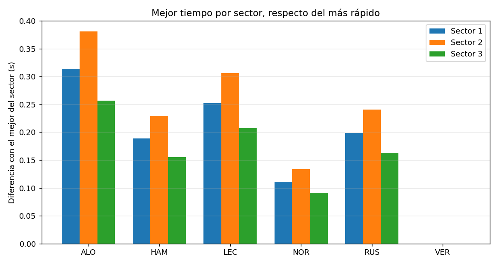

# Comparador de vueltas de Fórmula 1

**Autor:** Tomás Cappa
**Materia:** Programación Orientada a Datos – Licenciatura en Ciencia de Datos – UCA Rosario, 2026
**Trabajo:** TP2 individual

## Inicio rápido

Con el entorno preparado y activado ([guía para Linux y Windows](REPRODUCIBILIDAD.md)), ejecutá desde la raíz del repositorio:

```bash
python src/main.py --entrada data/sesion_f1.csv --sin-graficos
python -m unittest discover -s tests -v
```

El análisis debe informar 91 registros leídos, 84 válidos, 7 rechazados, 4 vueltas excluidas y 80 utilizadas. Genera comparaciones por piloto y sector, además de archivos para revisar rechazos e incidencias en `outputs/`; los gráficos también se guardan allí si se instala `matplotlib`. La tabla de [archivos de salida](#archivos-de-salida-carpeta-outputs) explica cada reporte. Las pruebas deben finalizar con `OK`.

## Problema y solución

Después de una sesión de entrenamientos, un equipo necesita distinguir si un piloto fue rápido en una vuelta aislada, si mantuvo un ritmo regular y en qué partes del circuito se puede estar perdiendo tiempo. La tarea se complica cuando el registro incluye formatos distintos, datos faltantes o repetidos, vueltas de entrada o salida de boxes y sectores que no coinciden con el tiempo total.

El proyecto automatiza esa primera lectura: valida y limpia los registros, deja constancia de los rechazos y exclusiones, compara los tiempos por piloto y genera tablas y gráficos para explicar qué se observa. Su finalidad es apoyar una conversación inicial sobre el ritmo de una sesión, no decidir por sí solo la estrategia de carrera.

### Preguntas de análisis y resolución teórica

Con el archivo de ejemplo, la aplicación lee 91 registros, acepta 84 y rechaza 7 por problemas de calidad. Luego excluye 4 vueltas válidas que no son adecuadas para comparar y calcula las métricas con las 80 restantes. A partir de esos resultados, se plantean estas preguntas:

1. **¿Quién consiguió la vuelta más rápida?** VER marcó la mejor vuelta de la sesión, con **1:24.675**. NOR quedó a **0.336 s**. Esto responde quién logró el mejor registro puntual, pero una sola vuelta no alcanza para decidir quién sostuvo el mejor ritmo.
2. **¿Quién tuvo el ritmo más regular?** LEC presenta el menor desvío estándar (**0.219 s**), por lo que sus tiempos utilizados fueron los más agrupados alrededor de su media. No significa que haya sido el más rápido: su mejor vuelta fue **1:25.440**, mientras que la de VER fue más rápida. Rapidez máxima y regularidad son aspectos distintos.
3. **¿Quién mostró el mejor ritmo promedio?** VER tuvo la media más baja (**1:25.318**), seguido de NOR (**1:25.409**). Como en los tiempos de vuelta un valor menor es más rápido, el promedio favorece a VER en esta sesión. La diferencia entre ambos es pequeña y, al tratarse de datos simulados y una sola sesión, no permite concluir que esa ventaja se repetiría en una carrera real.
4. **¿El gráfico de sectores permite afirmar en qué sector es mejor cada piloto?** No con estos datos. Los sectores simulados se construyen como proporciones fijas del tiempo total (33 %, 40 % y 27 %). Por eso, sus diferencias repiten proporcionalmente las diferencias generales de ritmo y no representan fortalezas reales en una parte del circuito. Con datos reales, comparar las diferencias por sector sí ayudaría a localizar dónde se gana o pierde tiempo.
5. **¿Por qué hay que revisar la evolución vuelta a vuelta además de las medias?** El gráfico permite ver cambios de ritmo y reconocer vueltas excluidas —por ejemplo, posibles vueltas de boxes— que podrían distorsionar una comparación. En este ejemplo se excluyeron cuatro vueltas con incidencias; los registros rechazados y sus motivos también quedan disponibles para revisar la limpieza.

**Conclusión del ejemplo:** VER combina la vuelta más rápida con la mejor media, mientras que LEC es quien muestra mayor regularidad. La lectura depende de qué se quiera evaluar: pico de velocidad, ritmo promedio o consistencia. Los gráficos orientan la interpretación, pero sus conclusiones deben limitarse a esta sesión simulada.

La tabla de comparación muestra cuántas vueltas se usaron, la mejor vuelta, la media, el desvío estándar y la diferencia respecto del mejor tiempo. Un desvío menor indica tiempos más parejos dentro de esta sesión.

### Funcionalidades

- Leer una sesión desde CSV o JSON (misma interfaz para ambos).
- Convertir tiempos en dos escrituras a segundos.
- Validar esquema, formato, rangos, sectores y duplicados; aceptar vueltas numéricas decimales cuando representan enteros (por ejemplo, `2.0`).
- Generar `rechazos.csv` (registros descartados con su motivo) e `incidencias.csv` (vueltas válidas excluidas de la comparación).
- Comparar todos los pilotos o sólo los elegidos, con tolerancia de sectores configurable.
- Informar qué vueltas se usaron para cada piloto.
- Comparar sectores: mejor tiempo de cada sector por piloto y "vuelta ideal" (suma de sus mejores sectores).
- Generar cuatro gráficos (opcional, con matplotlib).

### Alcance de la primera versión

La primera versión trabaja con una sesión por archivo y hasta tres sectores por vuelta. No descarga datos reales ni analiza neumáticos, clima o estrategias; tampoco incluye una interfaz web o aprendizaje automático.

### Cómo recorrer el repositorio

| Necesitás... | Consultá... |
|---|---|
| Preparar una entrada o consultar el conjunto de prueba | [Formato y datos de prueba](data/README.md) |
| Reproducir el proyecto en Linux o Windows | [Guía de reproducibilidad](REPRODUCIBILIDAD.md) |
| Entender el flujo del programa | [Organización del código](#3-organización-del-código) |
| Consultar validaciones y diagnosticar entradas | [Decisiones de limpieza](#4-decisiones-de-limpieza) |
| Ejecutar las verificaciones automáticas | [Pruebas](tests/README.md) |
| Consultar qué se verificó en la última ejecución | [Registro de validación](VALIDACION.md) |
| Consultar los archivos que genera | [Archivos de salida](#archivos-de-salida-carpeta-outputs) |
| Ver los gráficos incluidos | [Gráficos del ejemplo](#gráficos) |

## 2. Conjunto de prueba y formato de entrada

Los archivos `data/sesion_f1.csv` y `data/sesion_f1.json` forman un conjunto de prueba simulado: cada fila representa una vuelta y se incluyen registros válidos, errores deliberados e incidencias para comprobar el flujo de lectura, validación, limpieza y análisis. No son mediciones de una sesión real. Las pruebas automatizadas también usan estos archivos para verificar la lectura y la equivalencia entre CSV y JSON.

Para preparar otras entradas, consultá en [`data/README.md`](data/README.md) el esquema requerido, ejemplos de cada formato y el resultado esperado al procesar el conjunto de prueba.

## 3. Organización del código

```
.
|-- README.md
|-- requirements.txt
|-- .gitignore
|-- src/
|   |-- main.py       # argumentos y coordinación del flujo
|   |-- fuentes.py    # FuenteDatos (abstracta), FuenteCSV, FuenteJSON
|   |-- modelos.py    # clase Vuelta
|   |-- pipeline.py   # validación, limpieza, selección, comparación, exportación
|   `-- graficos.py   # gráficos con matplotlib (opcional)
|-- tests/            # pruebas automatizadas con unittest
|-- data/             # conjunto de datos de prueba simulado (CSV y JSON)
|-- scripts/
|   `-- generar_datos.py
|-- docs/             # imágenes de ejemplo de los gráficos (las usa este README)
`-- outputs/          # se genera al ejecutar (no se versiona)
```

**Flujo:** leer → inspeccionar y validar → limpiar y transformar → analizar → comunicar.

```
fuente.cargar(ruta)  ->  normalizar_campos  ->  validar_esquema
   ->  limpiar_datos (vueltas, rechazos)  ->  seleccionar_vueltas (selección, incidencias)
   ->  comparar_pilotos / comparar_sectores  ->  verificar_resultado  ->  guardar_* y gráficos
```

### Conceptos aplicados y justificación

- **Funciones con responsabilidad única:** una para cada etapa (`normalizar_campos`, `validar_esquema`, `limpiar_datos`, `seleccionar_vueltas`, `comparar_pilotos`, `verificar_resultado`, `guardar_*`). Reciben datos ya cargados, por lo que no dependen del formato del archivo.
- **Clase `Vuelta`:** reúne los datos de una vuelta y el comportamiento que le pertenece (`suma_sectores`, `diferencia_sectores`, `es_consistente`). La selección de vueltas usa esos métodos en lugar de repetir cuentas.
- **Abstracción de fuentes:** `FuenteDatos` define el contrato `cargar(ruta)`; `FuenteCSV` y `FuenteJSON` lo implementan y devuelven la misma estructura (lista de diccionarios de texto). Agregar otro formato no obliga a tocar el resto del programa. `fuente_para(ruta)` elige la implementación según la extensión.
- **Expresiones regulares** (`pipeline.py`):
  - `^[A-Z]{3}$` valida que el código de piloto sean exactamente tres letras mayúsculas.
  - `^(?:(\d{1,2}):([0-5]\d)|(\d{1,3}))\.(\d{1,3})$` valida la *forma* del tiempo: `M:SS.mmm` (con los segundos entre 00 y 59) o `SS.mmm`.
  - La regex **no** garantiza que el valor sea razonable, por eso se complementa con una comprobación de rango (30 a 300 s) y, en los sectores, con conversión numérica y rango.
- **Validaciones y errores comprensibles:** columnas faltantes, archivo inexistente, JSON mal formado, piloto desconocido (informa los disponibles) y parámetros inválidos terminan con un mensaje claro y código de salida 1.

## 4. Decisiones de limpieza

Cada registro se rechaza **una sola vez** (por el primer motivo que corresponda) y queda en `outputs/rechazos.csv` con su número de registro y el motivo. Nada se descarta en silencio.

| Regla | Qué hace | Justificación |
|---|---|---|
| Código de piloto inválido | Rechaza | No se puede asignar la vuelta a un piloto |
| Número de vuelta no entero o < 1 | Rechaza | Identificador inválido |
| Tiempo vacío | Rechaza ("vuelta incompleta") | No hay dato para comparar; **no** se convierte en cero |
| Tiempo con formato inválido | Rechaza | No se puede interpretar |
| Tiempo fuera de 30–300 s | Rechaza | Valor físicamente irreal |
| Sectores incompletos o inválidos | Rechaza | Se aceptan los tres sectores o ninguno |
| Duplicado (piloto, vuelta) | Rechaza el segundo | Se conserva el primer registro para no contar dos veces |

Las siguientes exclusiones **no** son errores de datos, sino criterios de comparación (quedan en `outputs/incidencias.csv`):

| Regla | Qué hace |
|---|---|
| Sectores inconsistentes | Excluye si `|tiempo − (s1+s2+s3)| >` tolerancia |
| Vuelta lenta | Excluye si el tiempo supera `1.15 ×` la mediana del piloto (probable vuelta de boxes); sólo se evalúa con 3 o más vueltas |

### Si una entrada está mal cargada

Primero distinguí un problema del **archivo completo** de un error en una **fila**. Si falta el archivo, el formato no es compatible, el encabezado no contiene las columnas obligatorias o el JSON está mal formado, el programa muestra un error en la terminal y termina con código `1`. Si una fila no pasa la validación, se anota en `rechazos.csv` con su número y el primer motivo; las demás filas válidas siguen procesándose. Las vueltas válidas que se excluyen por criterios de análisis quedan en `incidencias.csv`, no en rechazos.

Para diagnosticar sin sobrescribir los reportes habituales, ejecutá desde la raíz del repositorio:

```bash
python src/main.py --entrada ruta/a/mi_sesion.csv --salida /tmp/diagnostico --sin-graficos
```

Revisá el mensaje de la terminal y, si el proceso pudo leer el esquema, abrí `/tmp/diagnostico/rechazos.csv` e `/tmp/diagnostico/incidencias.csv`. Corregí el archivo de entrada según el motivo y volvé a ejecutar el mismo comando. Por ejemplo, `tiempo vacío` se corrige cargando un tiempo como `1:25.123`; `sectores incompletos` requiere completar `s1`, `s2` y `s3` o dejar los tres vacíos. No hace falta corregir el archivo de ejemplo para correr las pruebas automáticas.

| Qué observás | Qué revisar |
|---|---|
| `No se encontró el archivo de entrada` | La ruta de `--entrada` se interpreta desde la carpeta actual. Ejecutá el comando desde la raíz del proyecto o corregí la ruta. |
| `Formato no soportado` | Usá la extensión `.csv` o `.json`. |
| `Faltan columnas obligatorias` | Asegurate de que el CSV tenga encabezado y contenga `piloto`, `vuelta` y `tiempo`; revisá también la estructura del JSON. |
| Se genera una fila en `rechazos.csv` | Corregí el valor indicado en `motivo`: por ejemplo, tiempo vacío o con formato incorrecto, vuelta no entera, piloto inválido, sectores incompletos o clave piloto-vuelta duplicada. Cada registro informa sólo el primer error que encontró. |
| Se genera una fila en `incidencias.csv` | La fila pasó la validación básica, pero se excluyó del análisis: verificá la diferencia entre tiempo total y sectores o revisá si fue una vuelta lenta. |
| `Ningún registro superó la validación` | Todas las filas fueron rechazadas. Revisá `outputs/rechazos.csv` para ver el motivo de cada una; no se generan los CSV de comparación ni de incidencias. Corregí los datos y volvé a ejecutar. |
| `El JSON ... no es válido` o no tiene el formato esperado | Validá la sintaxis y usá una lista de objetos o un objeto con una lista en `vueltas`. |

**Casos límite resueltos explícitamente:** con una sola vuelta válida el desvío queda vacío con la nota "dispersión no definida"; un piloto sin vueltas utilizables aparece en la tabla con la nota "sin vueltas utilizables".

## 5. Ejemplo de resultado

Con `python src/main.py --entrada data/sesion_f1.csv`:

```
Registros leídos:      91
Registros válidos:     84
Registros rechazados:  7  -> outputs/rechazos.csv
Vueltas excluidas:     4  -> outputs/incidencias.csv
Vueltas utilizadas:    80

Piloto  Vueltas      Mejor      Media  Desvío(s)  Dif.mejor(s)  Nota
VER          15   1:24.675   1:25.318      0.414         0.000
NOR          13   1:25.011   1:25.409      0.292         0.336
HAM          14   1:25.248   1:25.738      0.377         0.573
RUS          14   1:25.278   1:26.040      0.434         0.603
LEC          12   1:25.440   1:25.750      0.219         0.765
ALO          12   1:25.627   1:26.176      0.426         0.952
```

Ejemplo de `outputs/rechazos.csv`:

```
registro,piloto,vuelta,motivo
8,VER,7,duplicado de VER vuelta 7 (ya figura en el registro 7)
21,NOR,5,formato de tiempo no reconocido: '1:2x.456' (se esperaba M:SS.mmm o SS.mmm)
40,LEC,9,vuelta incompleta (sin tiempo)
```

Ejecutando con el JSON se obtiene exactamente el mismo reporte.

### Archivos de salida (carpeta `outputs/`)

| Archivo | Contenido |
|---|---|
| `comparacion_pilotos.csv` | Tabla de comparación por piloto |
| `comparacion_sectores.csv` | Mejor tiempo por sector y vuelta ideal |
| `rechazos.csv` | Registros descartados con su motivo |
| `incidencias.csv` | Vueltas válidas excluidas de la comparación |
| `grafico_*.png` | Cuatro gráficos (ver abajo) |

### Gráficos

**Mejor vuelta por piloto** (diferencia con la mejor de la sesión):



**Evolución del tiempo por vuelta** (las X y ▲ son vueltas excluidas):



**Dispersión de los tiempos** (boxplot):


**Mejor tiempo por sector** respecto del más rápido:



## 6. Limitaciones

- Los datos son simulados con un modelo simple; no hay clima, tráfico ni estrategia.
- La media y el desvío con pocas vueltas (12 a 15) son estimaciones poco robustas.
- La regla de vuelta lenta usa un umbral fijo (1,15 × la mediana), que puede no ser adecuado en otros circuitos o con bandera roja.
- Una vuelta con los tres sectores mal cargados pero consistentes entre sí no puede detectarse.
- Una sola sesión por archivo y sólo tres sectores.
- En los datos simulados los sectores son proporciones fijas del tiempo total, por eso el gráfico de sectores no muestra diferencias de carácter entre pilotos (con datos reales sí las habría).

## 7. Control de versiones

Historial de desarrollo en este repositorio. La entrega se identifica con la etiqueta `v1.0-entrega`; [`ENTREGA.md`](ENTREGA.md) registra el enlace al repositorio y el hash del commit de código evaluado.
