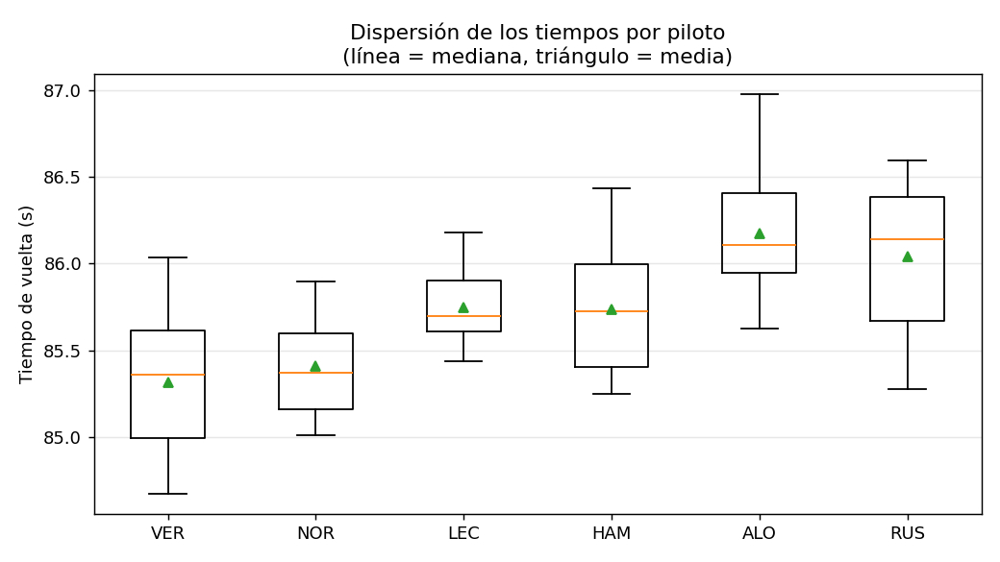

# Validador de sesiones y comparador de vueltas (Fórmula 1)

**Autor:** Tomás Cappa  
**Materia:** Programación Orientada a Datos – Licenciatura en Ciencia de Datos – UCA Rosario, 2026  
**Trabajo:** TP2 individual

## 1. Problema, usuario y solución propuesta

**Problema.** Al revisar una sesión de automovilismo, los tiempos de vuelta llegan escritos de distintas maneras (`1:25.123` o `85.123`), con vueltas incompletas, registros repetidos y sectores que no suman el tiempo total. Compararlos a mano es lento y difícil de repetir.

**Usuario.** Una persona que analiza el rendimiento de pilotos (estudiante, aficionado o integrante de un equipo) y necesita una comparación confiable sin limpiar los datos manualmente.

**Solución.** Una aplicación de consola que importa una sesión (CSV o JSON), valida cada registro, separa lo que no sirve **explicando el motivo**, excluye las vueltas no representativas y compara a los pilotos elegidos.

**Resultado e interpretación.** Una tabla por piloto con cantidad de vueltas utilizadas, mejor vuelta, media, desvío estándar y diferencia con el mejor tiempo. Un desvío bajo indica un ritmo regular; la media más cercana a la mejor vuelta indica mejor consistencia.

### Funcionalidades

- Leer una sesión desde CSV o JSON (misma interfaz para ambos).
- Convertir tiempos en dos escrituras a segundos.
- Validar esquema, formato, rangos, sectores y duplicados.
- Generar `rechazos.csv` (registros descartados con su motivo) e `incidencias.csv` (vueltas válidas excluidas de la comparación).
- Comparar todos los pilotos o sólo los elegidos, con tolerancia de sectores configurable.
- Informar qué vueltas se usaron para cada piloto.
- Comparar sectores: mejor tiempo de cada sector por piloto y "vuelta ideal" (suma de sus mejores sectores).
- Generar cuatro gráficos (opcional, con matplotlib).

### Alcance de la primera versión

**Incluye:** una sesión por archivo, tres sectores por vuelta, comparación estadística básica por piloto.  
**Queda fuera:** descarga automática de datos reales, interfaz web, análisis por tipo de neumático o clima, aprendizaje automático.

## 2. Datos

Sesión **simulada** (semilla fija) con 91 registros y 6 variables, equivalente en CSV y JSON. Está documentada en detalle en [`data/README.md`](data/README.md).

- **Fuente:** generada con `scripts/generar_datos.py` (no son tiempos reales).
- **Responsable y licencia:** obra propia del autor, de libre uso académico. Fecha de generación: 13/10/2026.
- **Unidad de análisis:** una fila = una vuelta cronometrada de un piloto.
- **Variables:** `piloto`, `vuelta`, `tiempo`, `s1`, `s2`, `s3`.
- **Limitaciones:** modelo de tiempos simplificado; ver `data/README.md`.

## 3. Instalación y uso

Requiere **Python 3.9 o superior**. El análisis usa sólo la biblioteca estándar; `matplotlib` se necesita únicamente para los gráficos (si no está instalado, la aplicación avisa y sigue sin ellos).

```bash
git clone https://github.com/chuchitoxx/Tp2_Tomas_Cappa_F1.git
cd Tp2_Tomas_Cappa_F1/tp2-cappa
```

(Opcional) entorno virtual:

```bash
python -m venv .venv
# Windows:  .venv\Scripts\activate
# Linux/Mac: source .venv/bin/activate
pip install -r requirements.txt
```

**Ejecutar la aplicación:**

```bash
python src/main.py --entrada data/sesion_f1.csv
python src/main.py --entrada data/sesion_f1.json
python src/main.py --entrada data/sesion_f1.csv --pilotos VER NOR LEC --tolerancia 0.1
```

| Argumento | Descripción | Por defecto |
|---|---|---|
| `--entrada` | Archivo `.csv` o `.json` (obligatorio) | — |
| `--pilotos` | Códigos a comparar | todos |
| `--tolerancia` | Diferencia máxima (s) entre tiempo total y suma de sectores | `0.05` |
| `--umbral-lenta` | Una vuelta es lenta si supera este múltiplo de la mediana del piloto | `1.15` |
| `--salida` | Carpeta de salida | `outputs` |
| `--sin-graficos` | No genera los gráficos (no requiere matplotlib) | — |

**Ejecutar las pruebas:**

```bash
python -m unittest discover -s tests -v
```

**Regenerar los datos simulados** (opcional): `python scripts/generar_datos.py`

## 4. Organización del código

```
Tp2_Tomas_Cappa/
|-- README.md
|-- requirements.txt
|-- .gitignore
|-- src/
|   |-- main.py       # argumentos y coordinación del flujo
|   |-- fuentes.py    # FuenteDatos (abstracta), FuenteCSV, FuenteJSON
|   |-- modelos.py    # clase Vuelta
|   |-- pipeline.py   # validación, limpieza, selección, comparación, exportación
|   `-- graficos.py   # gráficos con matplotlib (opcional)
|-- tests/            # pruebas con unittest
|-- data/             # sesión simulada (CSV y JSON) y su documentación
|-- scripts/
|   `-- generar_datos.py
|-- docs/             # imágenes de ejemplo de los gráficos (las usa este README)
`-- outputs/          # se genera al ejecutar (no se versiona)
```

**Flujo:** leer → inspeccionar y validar → limpiar y transformar → analizar → comunicar.

```
fuente.cargar(ruta)  ->  normalizar_campos  ->  validar_esquema
   ->  limpiar_datos (vueltas, rechazos)  ->  seleccionar_vueltas (selección, incidencias)
   ->  comparar_pilotos / comparar_sectores  ->  verificar_resultado  ->  guardar_* y gráficos
```

### Conceptos aplicados y justificación

- **Funciones con responsabilidad única:** una para cada etapa (`normalizar_campos`, `validar_esquema`, `limpiar_datos`, `seleccionar_vueltas`, `comparar_pilotos`, `verificar_resultado`, `guardar_*`). Reciben datos ya cargados, por lo que no dependen del formato del archivo.
- **Clase `Vuelta`:** reúne los datos de una vuelta y el comportamiento que le pertenece (`suma_sectores`, `diferencia_sectores`, `es_consistente`). La selección de vueltas usa esos métodos en lugar de repetir cuentas.
- **Abstracción de fuentes:** `FuenteDatos` define el contrato `cargar(ruta)`; `FuenteCSV` y `FuenteJSON` lo implementan y devuelven la misma estructura (lista de diccionarios de texto). Agregar otro formato no obliga a tocar el resto del programa. `fuente_para(ruta)` elige la implementación según la extensión.
- **Expresiones regulares** (`pipeline.py`):
  - `^[A-Z]{3}$` valida que el código de piloto sean exactamente tres letras mayúsculas.
  - `^(?:(\d{1,2}):([0-5]\d)|(\d{1,3}))\.(\d{1,3})$` valida la *forma* del tiempo: `M:SS.mmm` (con los segundos entre 00 y 59) o `SS.mmm`.
  - La regex **no** garantiza que el valor sea razonable, por eso se complementa con una comprobación de rango (30 a 300 s) y, en los sectores, con conversión numérica y rango.
- **Validaciones y errores comprensibles:** columnas faltantes, archivo inexistente, JSON mal formado, piloto desconocido (informa los disponibles) y parámetros inválidos terminan con un mensaje claro y código de salida 1.

## 5. Decisiones de limpieza

Cada registro se rechaza **una sola vez** (por el primer motivo que corresponda) y queda en `outputs/rechazos.csv` con su número de registro y el motivo. Nada se descarta en silencio.

| Regla | Qué hace | Justificación |
|---|---|---|
| Código de piloto inválido | Rechaza | No se puede asignar la vuelta a un piloto |
| Número de vuelta no entero o < 1 | Rechaza | Identificador inválido |
| Tiempo vacío | Rechaza ("vuelta incompleta") | No hay dato para comparar; **no** se convierte en cero |
| Tiempo con formato inválido | Rechaza | No se puede interpretar |
| Tiempo fuera de 30–300 s | Rechaza | Valor físicamente irreal |
| Sectores incompletos o inválidos | Rechaza | Se aceptan los tres sectores o ninguno |
| Duplicado (piloto, vuelta) | Rechaza el segundo | Se conserva el primer registro para no contar dos veces |

Las siguientes exclusiones **no** son errores de datos, sino criterios de comparación (quedan en `outputs/incidencias.csv`):

| Regla | Qué hace |
|---|---|
| Sectores inconsistentes | Excluye si `|tiempo − (s1+s2+s3)| >` tolerancia |
| Vuelta lenta | Excluye si el tiempo supera `1.15 ×` la mediana del piloto (probable vuelta de boxes); sólo se evalúa con 3 o más vueltas |

**Casos límite resueltos explícitamente:** con una sola vuelta válida el desvío queda vacío con la nota "dispersión no definida"; un piloto sin vueltas utilizables aparece en la tabla con la nota "sin vueltas utilizables".

## 6. Ejemplo de resultado

Con `python src/main.py --entrada data/sesion_f1.csv`:

```
Registros leídos:      91
Registros válidos:     84
Registros rechazados:  7  -> outputs/rechazos.csv
Vueltas excluidas:     4  -> outputs/incidencias.csv
Vueltas utilizadas:    80

Piloto  Vueltas      Mejor      Media  Desvío(s)  Dif.mejor(s)  Nota
VER          15   1:24.675   1:25.318      0.414         0.000
NOR          13   1:25.011   1:25.409      0.292         0.336
HAM          14   1:25.248   1:25.738      0.377         0.573
RUS          14   1:25.278   1:26.040      0.434         0.603
LEC          12   1:25.440   1:25.750      0.219         0.765
ALO          12   1:25.627   1:26.176      0.426         0.952
```

Ejemplo de `outputs/rechazos.csv`:

```
registro,piloto,vuelta,motivo
8,VER,7,duplicado de VER vuelta 7 (ya figura en el registro 7)
21,NOR,5,formato de tiempo no reconocido: '1:2x.456' (se esperaba M:SS.mmm o SS.mmm)
40,LEC,9,vuelta incompleta (sin tiempo)
```

Ejecutando con el JSON se obtiene exactamente el mismo reporte.

### Archivos de salida (carpeta `outputs/`)

| Archivo | Contenido |
|---|---|
| `comparacion_pilotos.csv` | Tabla de comparación por piloto |
| `comparacion_sectores.csv` | Mejor tiempo por sector y vuelta ideal |
| `rechazos.csv` | Registros descartados con su motivo |
| `incidencias.csv` | Vueltas válidas excluidas de la comparación |
| `grafico_*.png` | Cuatro gráficos (ver abajo) |

### Gráficos

**Mejor vuelta por piloto** (diferencia con la mejor de la sesión):


**Evolución del tiempo por vuelta** (las X y ▲ son vueltas excluidas):


**Dispersión de los tiempos** (boxplot):



**Mejor tiempo por sector** respecto del más rápido:


## 7. Interpretación y limitaciones

- **Interpretación:** en esta sesión simulada VER tiene la mejor vuelta; LEC es el piloto más regular (menor desvío) y RUS, ALO y VER son los de ritmo más variable. Las conclusiones valen sólo para los datos simulados.
- **Limitaciones:**
  - Los datos son simulados con un modelo simple; no hay clima, tráfico ni estrategia.
  - La media y el desvío con pocas vueltas (12 a 15) son estimaciones poco robustas.
  - La regla de vuelta lenta usa un umbral fijo (1,15 × la mediana), que puede no ser adecuado en otros circuitos o con bandera roja.
  - Una vuelta con los tres sectores mal cargados pero consistentes entre sí no puede detectarse.
  - Una sola sesión por archivo y sólo tres sectores.
  - En los datos simulados los sectores son proporciones fijas del tiempo total, por eso el gráfico de sectores no muestra diferencias de carácter entre pilotos (con datos reales sí las habría).

## 8. Control de versiones

Historial de desarrollo en este repositorio. La versión evaluada se identifica con la etiqueta `v1.0-entrega` (o con el hash del último commit indicado en la entrega).
